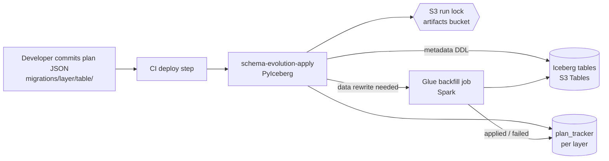

# Architecture

## Components

| Component | Location | Role |
|---|---|---|
| Core library + CLIs | `src/schema_evolution/` | Plan discovery, classification, PyIceberg DDL, tracker, lock, backfill launch |
| Backfill job | `src/schema_evolution_spark/schema_evolution_backfill.py` | Spark rewrite for changes metadata cannot express |
| Env-column backfill job | `src/schema_evolution_spark/backfill_new_columns.py` | Manual MERGE that fills environment-gated columns from Bronze |
| CDK stack | `infra/stacks/schema_evolution_stack.py` | Artifacts bucket, both Glue jobs and their role, and the applier policy for your CI role |

Everything is driven by `schema-evolution-apply`, which your deploy runs. Nothing runs on a schedule and nothing listens for events.

## How a pass works

`apply_migrations` in `apply.py`:

1. **Lock.** Take the per-environment S3 lock (`locks/{env}.lock` in the artifacts bucket). It uses a conditional `PutObject` with `If-None-Match: *` and has a 20-minute TTL, refreshed by a heartbeat. A second deploy waits for it (`--lock_wait_seconds`, default 15 minutes), then fails.
2. **Discover.** List `migrations/<layer>/<table>/*.json`. Plans for one table run in filename order, so timestamp prefixes set the order. Up to `--max_workers` tables (default 4) run in parallel.
3. **Filter.** `plan_targets_environment` drops plans whose `metadata.environments` excludes this environment.
4. **Read the tracker.** One scan of `schema_evolution_metadata.plan_tracker` per layer. Plans already `applied` are skipped. If a table has a plan in `backfilling`, its later plans wait (see below).
5. **Checksum.** The toolkit recomputes the SHA-256 of each applied plan's `changes`. If one was edited after it was applied, the default is to fail (`--checksum_mode` / `SCHEMA_EVOLUTION_CHECKSUM_MODE`: `fail|warn|off`).
6. **Missing tables.** If the table does not exist yet, the plans are marked `waiting_for_table` and retried on the next run. A `rename_table` plan counts the source table as present.
7. **Apply.** `apply_ddl` runs each change with PyIceberg. Every branch is idempotent: adding an existing column, dropping a missing one, or retyping to the current type is a no-op.
8. **Backfill.** Changes that need a data rewrite return `BACKFILL_NEEDED`. After the plan's metadata changes are applied, `trigger_backfill` starts **one** Glue job run with all of the plan's backfill changes, and the plan is marked `backfilling`. If a type change targets a column that backs a partition field and has no `new_partition`, the plan fails (`PartitionSourceColumnError`) so the table is never left half-migrated.
9. **Record.** Tracker rows are written in one commit per batch, with retries and jitter on Iceberg commit conflicts.
10. **Heal.** A `backfilling` row whose Glue run is dead (FAILED, TIMEOUT, STOPPED, ERROR) is reset to `failed`, so the plan is retried.

## What happens after a backfill starts

Apply does not wait for a backfill it has just started. It marks the plan `backfilling`, stops applying that table's later plans, carries on with the other tables, and finishes. The Glue job runs on its own and writes `applied` or `failed` to the tracker when it ends.

On the **next** run (normally your next deploy), for that table:

| Backfill state | What apply does | Run result |
|---|---|---|
| Finished, `applied` | Applies the table's remaining plans | Success |
| Still running | Polls every 30 seconds for up to 5 minutes. If it finishes, applies the remaining plans. If not, logs `Backfill still running (Glue run ...)`, skips the table, and lists it in a summary at the end | **Success**. The remaining plans apply on a later run |
| Glue run died | Resets the plan to `failed` and retries it | Depends on the retry |
| Finished, `failed` | Retries the plan | Fails if it fails again |

The other tables are never held up: they are processed in parallel, and only the table with the running backfill waits.

Put all of one table's backfill changes in **one plan**. That gives one Glue job (and at most one full table rebuild), and no later plans waiting behind it. Split them into separate plans only when one change must finish before the next starts.

> **Note.** ETL jobs that run right after a deploy may write to a table whose later plans have not applied yet. This happens while a backfill on that table is still running. With one plan per table it is rare. If a job depends on a change from such a plan, run it after the next deploy, or check the tracker first.

## What the backfill job does

The job runs one strategy per table.

- **Promotable widening** (int to long, float to double, decimal with the same scale and larger precision) uses `ALTER COLUMN ... TYPE`, which keeps the column id.
- **Non-promotable change on an unpartitioned column** runs four steps:
  1. Rename the column to `__backfill_tmp_<col>`.
  2. Add the column with the target type.
  3. Run `UPDATE ... SET col = <transformation or CAST>`.
  4. Drop the temp column.

  Each step checks current state first, so a re-run resumes where the last one stopped.
- **Non-promotable change on a partition-source column, a re-partition, `rebuild_table`, or a sort-order rebuild** runs a full rebuild:
  1. CTAS the data into `<table>_rebuild` with the new types, partition spec and sort order.
  2. Verify that row counts match.
  3. Abort if the source table took a data write during the copy.
  4. Delete the original table through the S3 Tables API.
  5. Rename the rebuilt table into place.

  Iceberg binds old partition specs by column name, so changing a partition column's id cannot be done in place.

If any change in the plan needs a rebuild, all of the plan's changes are applied in that one rebuild. Otherwise each change is applied in place, one after another, in the same job run.

When the job finishes it updates the tracker row to `applied` or `failed`. The next apply run continues from there.

## Security notes

- The Glue role and the applier policy are scoped to the three layer table buckets, the backfill job, and the artifacts bucket's `locks/` and `spark-ui/` prefixes.
- The artifacts bucket blocks public access, enforces TLS, is versioned and uses SSE-S3.
- No secrets are stored or read. Callers authenticate with their own AWS credentials, and Iceberg REST calls are SigV4-signed.
- `set_column_nullability` with `target_not_null: true` does not check existing data files. Make sure the column has no NULLs first.
